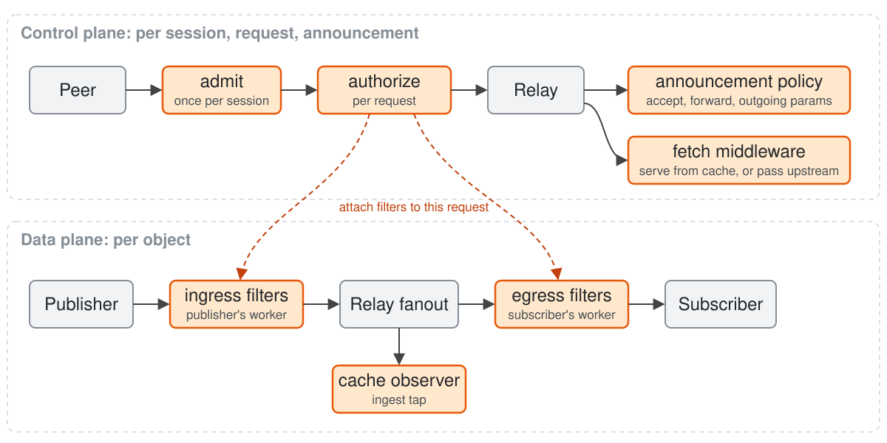
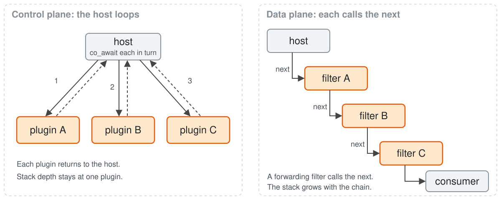
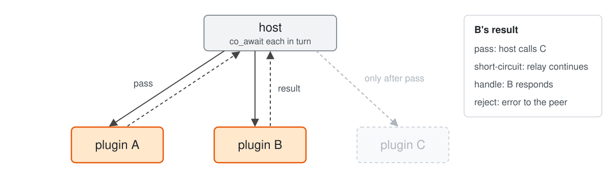
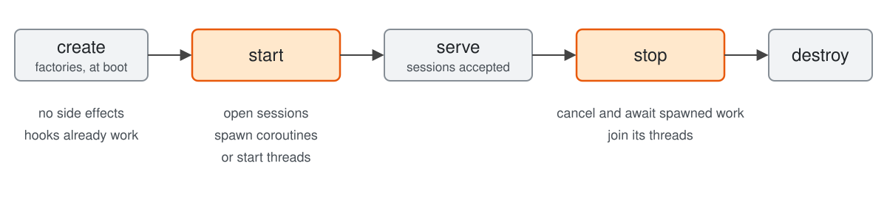
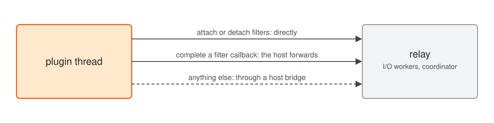
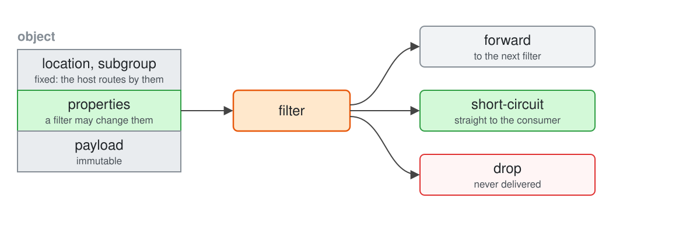
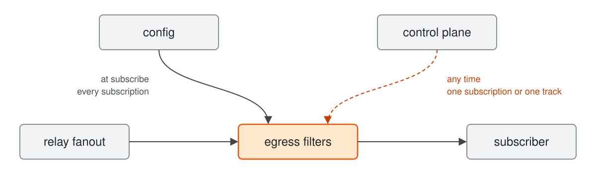

## moqx plugins

---

## Levels

| Level | Plugin is | For |
| --- | --- | --- |
| 1 | C++ compiled into moqx | In-tree plugins and forks that need native speed and accept a rebuild |
| 2 | A shared library, loaded at startup | Plugins shipped as separate packages |
| 3 | A trusted WebAssembly module | Operators changing behavior without a restart |
| 4 | An untrusted WebAssembly module | Tenants running their own code at the edge |

> **Open question:** When do we need Level 2?

> **Open question:** What logging facilities does Level 2 give plugins?

---

## Level 1

- Plugins are C++ and use folly directly.
- They live in the moqx tree, or a fork adds them through its CMake build.
- Adding a plugin means rebuilding moqx.
- The prototype already builds Auth, RelayHops and the cache as plugins.

---

## Level 1: boot

1. Config lists plugins by type name.
2. One list in the code maps each type name to a factory.
3. Each factory creates a `Plugin` per config entry.
4. Each `Plugin` creates a `ServicePlugin` per service it applies to.
5. Each `ServicePlugin` creates its worker instances on every I/O worker.
6. Each `ServicePlugin` runs its `start` hook, in config order.
7. The service accepts sessions.

---

## Control plane vs data plane

- Control plane hooks run once per session, request or announcement.
- Admitting a session is a control plane hook.
- Data plane hooks run per object.
- Filtering an object is a data plane hook.



---

## Coroutines vs callbacks



- A filter that needs to wait completes its callback later.
- The host then forwards the object on the owning I/O worker.

---

## Hooks: chains



- Each hook point runs its plugins in config order.
- Filters have three outcomes: forward, short-circuit or drop.

---

## Lifecycle hooks



- A plugin that only answers hooks needs no start work.

> **Open question:** For a plugin's own work: should the host offer spawned coroutines, plugin threads, or both? The answer shapes Level 2.

---

## Threads a plugin starts



---

## Filters: rules



---

## Filters: who puts them there



- The control plane can also remove what it attached.
- Ingress filters work the same way.
- A request update keeps the configured filters.

> **Open question:** In what order do attached filters run, among themselves and against configured ones?

---

## Use case: auth

```text
CLIENT_SETUP + token     ──▶ admit
SUBSCRIBE (+ token) ...  ──▶ authorize
```

- `admit` verifies the SETUP token and checks that it may connect.
- It keeps the token's grants, plus the anonymous grants, as session state.
- `authorize` checks each request against those grants, or against the request's own token.
- A check that calls an auth server suspends.
- The I/O worker serves other sessions meanwhile.
- A rejection answers with an error and stops the chain.

---

## Use case: MoQT track filter (top N)

```text
publisher  ──▶ ingress filter ── value, activity ──▶ coordinator: ranking
coordinator ── PUBLISH / PUBLISH_DONE ──▶ subscriber
```

- A configured ingress filter registers each published track with the coordinator.
- It reports the ranking property and the track's activity, and forwards objects unchanged.
- At the track's end, it removes the track from the ranking.
- The plugin handles `SUBSCRIBE_TRACKS`, and records its prefix, property and N.
- On a selection change, the coordinator publishes the track to the subscriber, or ends it.

> **Open question:** What host API lets a plugin publish an existing track to one subscriber?

---

## Use case: relay hops

```text
relay-a ──▶ relay-b ──▶ relay-c ──▶ relay-a   (dropped)
```

- The Hop ID lives in the `Plugin` root, shared by every service.
- `announce` handles an announcement whose path already holds this Hop ID by dropping it.
- `outgoing` appends this Hop ID to every forwarded announcement.

---

## Use case: default upstream

- Its routing hook sees each request with no local publisher.
- It handles the request by forwarding it upstream.
- It sits last in config order.
- Earlier plugins can handle a request first.

---

## Use case: watermark one subscriber

```text
subscriber ── SUBSCRIBE live/video/wm-<id> ──▶ relay
plugin     ── SUBSCRIBE live/video ──────────▶ relay   (local session)
plugin     ── PUBLISH   live/video/wm-<id> ──▶ relay   (new objects)
```

- `authorize` checks that `wm-<id>` belongs to the subscriber.
- Its routing hook handles the `wm-<id>` subscribe, before the default upstream.
- The relay serves it from the plugin's local session, an in-process peer.
- The local session subscribes to the source track.
- That subscribe reaches the default upstream like any other.
- The local session publishes `wm-<id>` with synthesized objects.

---

## How we start

- Start with Level 1.
- Land the Level 1 API with Auth, RelayHops and the cache as its first plugins.

## Open questions

- In what order do attached filters run, among themselves and against configured ones?
- For a plugin's own work: should the host offer spawned coroutines, plugin threads, or both?
  - Keep in mind level 2
- What host API lets a plugin publish an existing track to one subscriber?
- How do plugins expose metrics and admin routes?
- When do we need Level 2?
- What logging facilities does Level 2 give plugins?
- Plugins that don't fit into this model?
